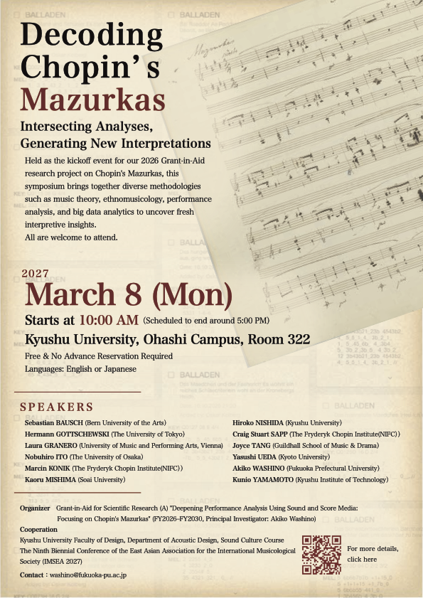

<!-- 右側のダウンロードエリア（英語版チラシ ＆ プログラムノート） -->

  
  <!-- 英語版チラシ枠 -->
  
  

    Click image to open Symposium Flyer (PDF).
  

  

  <!-- プログラムノート枠（開催間際に公開用） -->
  

    
Program Notes

    <!-- 開催間際に公開する際は、以下のコメントアウトを外し、リンクを設定してください -->
    <!-- <a href="program_note.pdf" target="_blank" style="font-size: 0.90rem;">Download (PDF)</a> -->
    To be published soon before the event
  

### **Symposium "Decoding Chopin's Mazurkas: Intersecting Analyses, New Interpretations"** 
<a href="index.html">Japanese</a>

This symposium is held as the kick-off event for our JSPS-funded research project on Chopin’s Mazurkas, which commenced this academic year. 
By intersecting multidisciplinary approaches—including music theory, ethnomusicology, performance analysis, and big data analysis—this research explores new interpretive possibilities to get to the core of the works. 
We look forward to welcoming you.

  <strong>Date:</strong> Monday, March 8, 2027, 10:00 start (scheduled to end around 17:00) 
  <strong>Venue:</strong> Classroom 322, Ohashi Campus, Kyushu University 
  4-9-1 Shiobaru, Minami-ku, Fukuoka 815-0032, Japan 
  <strong>Language:</strong> Japanese & English 
  
 <strong>Admission Free / No Registration Required</strong> 

 
 
<strong>Speakers:</strong> 
Sebastian BAUSCH (Bern University of the Arts) 
Hermann GOTTSCHEWSKI (The University of Tokyo) 
Laura GRANERO (University of Music and Performing Arts Vienna) 
Nobuhiro ITO (Osaka University) 
Marcin KONIK (The Fryderyk Chopin Institute) 
Kaoru MISHIMA (Soai University) 
Hiroko NISHIDA (Kyushu University) 
Craig Stuart SAPP (The Fryderyk Chopin Institute) 
Joyce TANG (Guildhall School of Music & Drama) 
Yasushi UEDA (Kyoto University) 
Akiko WASHINO (Fukuoka Prefectural University) 
Kunio YAMAMOTO (Kyushu Institute of Technology) 
 

<!-- 回り込みを解除するためのクリアタグ -->

  
  

    <strong>[Organizer]</strong> 
    Grant-in-Aid for Scientific Research (A) "Deepening Performance Analysis Using Sound and Score Media:
Focusing on Chopin's Mazurkas" 
     
    (2026–2030, Principal Investigator: Akiko Washino)
  

  

    <strong>[Co-organizer / Support]</strong> Sound Culture Course, Department of Acoustic Design, Faculty of Design, Kyushu University; The Ninth Biennial Conference of the East Asian Association for the International Musicological
Society (IMSEA 2027)

  

  

    <strong>[Contact]</strong> <a href="mailto:washino@fukuoka-pu.ac.jp">washino@fukuoka-pu.ac.jp</a>
  

 
*Further details will be updated as soon as they are finalized.
