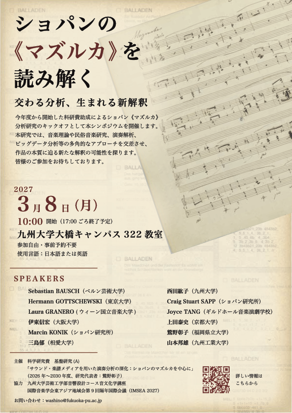
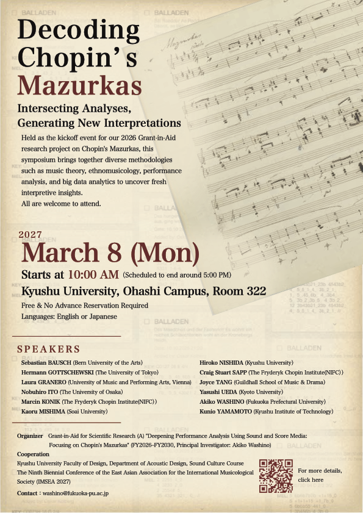

<!-- 右側のダウンロードエリア（日本語版・英語版チラシ ＆ プログラムノート） -->

  
  <!-- 日本語版チラシ枠 -->
  
  

    ※画像をクリックすると 開催チラシ（日本語・PDF）が開きます。
  

  

  <!-- 英語版チラシ枠 -->
  
  

    ※画像をクリックすると 開催チラシ（英語・PDF）が開きます。
  

  

  <!-- プログラムノート枠（開催間際に公開用） -->
  

    
プログラムノート

    <!-- 開催間際に公開する際は、以下のコメントアウトを外し、リンクを設定してください -->
    <!-- <a href="program_note.pdf" target="_blank" style="font-size: 0.9rem;">ダウンロード (PDF)</a> -->
    開催間際に公開予定です
  

### **シンポジウム「ショパンの《マズルカ》を読み解く：交わる分析、生まれる新解釈」** 
[English](index-en.html)

今年度から開始した科研費助成によるショパン《マズルカ》分析研究のキックオフとして本シンポジウムを開催します。
本研究では、音楽理論や民俗音楽研究、演奏解析、ビッグデータ分析等の多角的なアプローチを交差させ、作品の本質に迫る新たな解釈の可能性を探ります。
皆様のご参加をお待ちしております。

  <strong>日時：</strong>2027年3月8日（月）10:00開始（17:00頃終了予定） 
  <strong>会場：</strong>九州大学大橋キャンパス 322教室 
    福岡県福岡市南区塩原4丁目9-1 
  <strong>言語：</strong>日本語・英語 
  
 <strong>参加自由・事前予約不要</strong> 

 
 
<strong>登壇者：</strong> 
Sebastian BAUSCH（ベルン芸術大学） 
Hermann GOTTSCHEWSKI（東京大学） 
Laura GRANERO (ウィーン国立音楽大学) 
伊東信宏（大阪大学） 
Marcin KONIK（ショパン研究所） 
三島郁（相愛大学） 
西田紘子（九州大学） 
Craig Stuart SAPP（ショパン研究所） 
Joyce TANG（ギルドホール音楽演劇学校） 
上田泰史（京都大学） 
鷲野彰子（福岡県立大学） 
山本邦雄（九州工業大学） 
 

<!-- 回り込みを解除するためのクリアタグ -->

  
  

    <strong>【主 催】</strong>科学研究費 基盤研究(A)「サウンド・楽譜メディアを用いた演奏分析の深化：ショパンのマズルカを中心に」 
    （2026年～2030年度、研究代表者：鷲野彰子）
  

  

    <strong>【協 力】</strong>九州大学芸術工学部音響設計コース音文化学講座, 国際音楽学会東アジア地域会第9回隔年国際会議（IMSEA 2027）
  

  

    <strong>【問合せ】</strong><a href="mailto:washino@fukuoka-pu.ac.jp">washino@fukuoka-pu.ac.jp</a>
  

 
※詳細が決まり次第、情報を更新します。

